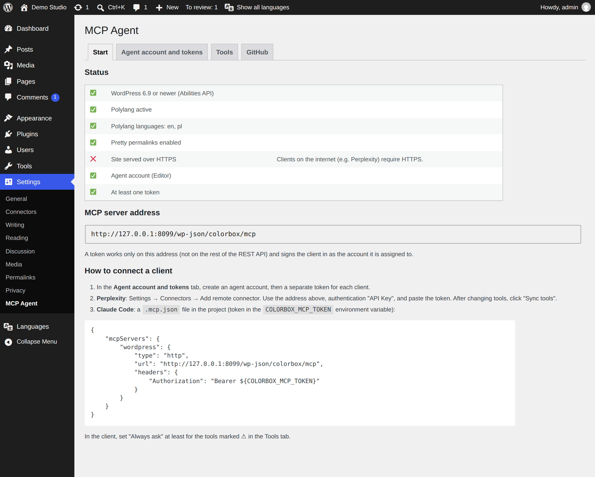
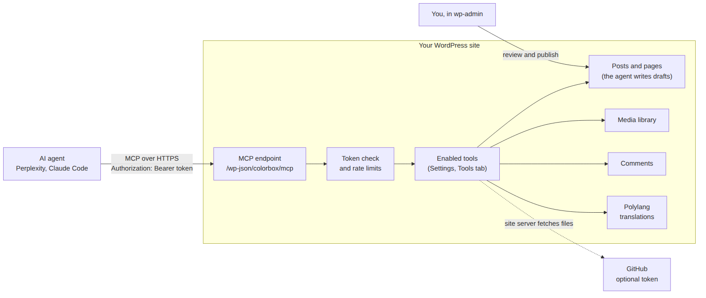

# Colorbox MCP — tools for AI agents

*[Polska wersja → README.pl.md](README.pl.md)*

A WordPress plugin that lets an AI agent (Perplexity, Claude Code or any MCP client) write and translate drafts,
add images and code, moderate comments and check your content — **without ever publishing anything**. You review
and publish; the agent does the legwork.

**Why:** an AI assistant is good at drafting, translating and tidying a blog, but giving it a WordPress password
gives it everything. This plugin gives it a narrow, switchable set of tools on a token that works nowhere else.



## What it can do

- **Drafts and pages** in any language you have in Polylang, with SEO description, categories and images.
- **Translations** linked to the original in Polylang.
- **Images** from GitHub, a web address or the agent itself, straight into the media library with alt text.
- **Code from GitHub** as a code block pinned to an exact commit, with a “Source” line.
- **Comment moderation** with spam signals: flag, hold, edit, trash — all reversible.
- **Content audit**: missing translations, featured images, SEO descriptions, alt texts, stale drafts, broken links.
- **Review queue**: finished drafts wait for you on the dashboard.
- Optional, off by default: **editing published posts** (with undo), **trash**, deleting unused images and categories.
- Admin panel and tool descriptions in **English and Polish**, following your WordPress language.



## Documentation

| Chapter | What is in it |
|---|---|
| [1. Installation](docs/en/01-installation.md) | Requirements, uploading the ZIP, updating, removing. |
| [2. Configuration](docs/en/02-configuration.md) | The settings panel: agent account, tokens, tools, GitHub, review queue. |
| [3. Connecting a client](docs/en/03-clients.md) | Perplexity, Claude Code, checking the connection. |
| [4. Tools](docs/en/04-tools.md) | All 28 tools, what the agent can never do, how to undo. |
| [5. Security](docs/en/05-security.md) | What a leaked token gives, limits, prompt injection. |
| [6. Troubleshooting](docs/en/06-troubleshooting.md) | Symptom → cause → fix. |
| [7. How it works](docs/en/07-how-it-works.md) | Files, stored data, design decisions, development. |

## Shortest path (about 15 minutes)

1. WordPress 6.9+, PHP 8.1+, [Polylang](https://wordpress.org/plugins/polylang/) with one language, pretty permalinks.
2. Download the ZIP from **Releases**, then **Plugins → Add Plugin → Upload Plugin → Activate**.
3. **Settings → MCP Agent → Agent account and tokens**: **Create agent account**, then **Create token**, copy it.
4. In your client: the address from the **Start** tab plus the token as `Authorization: Bearer <token>`.

## Repository layout

```
colorbox-wp-mcp.php   plugin entry point
includes/             the plugin code (one file per area)
languages/            Polish translation and the .pot template
vendor/               WordPress MCP Adapter (committed, no Composer needed)
bin/build-zip.sh      builds the installable ZIP
docs/                 this documentation (en/, pl/, img/)
tools/                demo site, screenshot script, diagram sources
```

## Status

Version 0.3.0. Used on a live bilingual (PL/EN) site with Perplexity and Claude Code. Tested on WordPress 7.1,
PHP 8.3 and Polylang 3.9. Not yet: OAuth (needed for claude.ai custom connectors), automatic updates, cleanup of
settings on uninstall.

Built on the official [WordPress MCP Adapter](https://github.com/WordPress/mcp-adapter) and the Abilities API from
WordPress core.

## License

[GPL-2.0-or-later](LICENSE), like WordPress itself.
