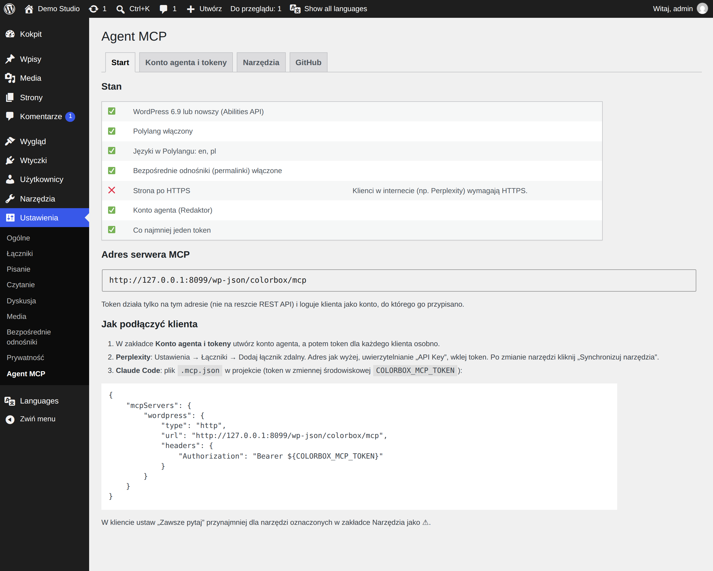
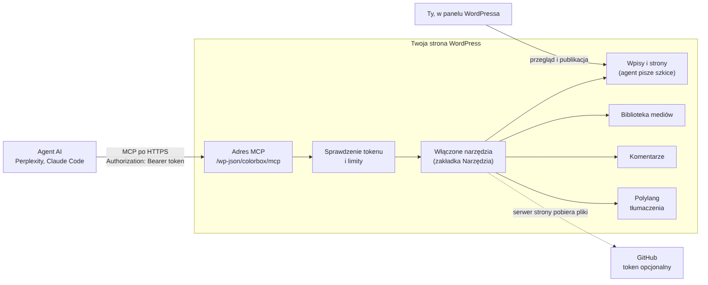

# Colorbox MCP — narzędzia dla agentów AI

*[English version → README.md](README.md)*

Wtyczka WordPressa, dzięki której agent AI (Perplexity, Claude Code albo inny klient MCP) pisze i tłumaczy szkice,
dodaje obrazki i kod, moderuje komentarze i sprawdza treści — **ale nigdy niczego nie publikuje**. Ty przeglądasz
i publikujesz; agent robi resztę.

**Po co:** asystent AI dobrze pisze, tłumaczy i porządkuje bloga, ale hasło do WordPressa daje mu wszystko. Ta
wtyczka daje mu wąski, przełączalny zestaw narzędzi na tokenie, który nigdzie indziej nie działa.



## Co potrafi

- **Szkice wpisów i stron** w każdym języku z Polylanga, z opisem SEO, kategoriami i obrazkami.
- **Tłumaczenia** połączone z oryginałem w Polylangu.
- **Obrazki** z GitHuba, z adresu w internecie albo od samego agenta, prosto do biblioteki mediów, z opisem alt.
- **Kod z GitHuba** jako blok kodu przypięty do konkretnego commita, z akapitem „Źródło”.
- **Moderacja komentarzy** z sygnałami spamu: oznaczenie, wstrzymanie, poprawka, kosz — wszystko odwracalne.
- **Przegląd treści**: brak tłumaczeń, obrazków wyróżniających, opisów SEO, tekstów alt, stare szkice, zepsute linki.
- **Kolejka do przeglądu**: gotowe szkice czekają na Ciebie w kokpicie.
- Opcjonalnie, domyślnie wyłączone: **poprawki opublikowanych wpisów** (z cofaniem), **kosz**, usuwanie
  nieużywanych obrazków i kategorii.
- Panel i opisy narzędzi **po polsku i po angielsku**, zgodnie z językiem WordPressa.



## Dokumentacja

| Rozdział | Co zawiera |
|---|---|
| [1. Instalacja](docs/pl/01-instalacja.md) | Wymagania, wysłanie ZIP-a, aktualizacja, usunięcie. |
| [2. Konfiguracja](docs/pl/02-konfiguracja.md) | Panel ustawień: konto agenta, tokeny, narzędzia, GitHub, kolejka do przeglądu. |
| [3. Podłączenie klienta](docs/pl/03-klienci.md) | Perplexity, Claude Code, sprawdzenie połączenia. |
| [4. Narzędzia](docs/pl/04-narzedzia.md) | Wszystkie 28 narzędzi, czego agent nigdy nie zrobi, jak cofać. |
| [5. Bezpieczeństwo](docs/pl/05-bezpieczenstwo.md) | Co daje wyciek tokenu, limity, wstrzykiwanie poleceń. |
| [6. Problemy](docs/pl/06-problemy.md) | Objaw → przyczyna → rozwiązanie. |
| [7. Jak to działa](docs/pl/07-jak-to-dziala.md) | Pliki, zapisywane dane, decyzje projektowe, rozwój. |

## Najkrótsza droga (około 15 minut)

1. WordPress 6.9+, PHP 8.1+, [Polylang](https://pl.wordpress.org/plugins/polylang/) z jednym językiem, bezpośrednie
   odnośniki inne niż „Prosty”.
2. Pobierz ZIP z **Releases**, potem **Wtyczki → Dodaj wtyczkę → Wyślij wtyczkę na serwer → Włącz**.
3. **Ustawienia → Agent MCP → Konto agenta i tokeny**: **Utwórz konto agenta**, potem **Utwórz token**, skopiuj go.
4. W kliencie: adres z zakładki **Start** i token jako `Authorization: Bearer <token>`.

## Układ repozytorium

```
colorbox-wp-mcp.php   punkt wejścia wtyczki
includes/             kod wtyczki (jeden plik na obszar)
languages/            tłumaczenie polskie i szablon .pot
vendor/               WordPress MCP Adapter (w repo, Composer niepotrzebny)
bin/build-zip.sh      buduje ZIP do instalacji
docs/                 ta dokumentacja (en/, pl/, img/)
tools/                strona demo, skrypt zrzutów, źródła schematów
```

## Stan projektu

Wersja 0.3.1. Działa na żywej stronie dwujęzycznej (PL/EN) z Perplexity i Claude Code. Przetestowana na WordPressie
7.1, PHP 8.3 i Polylangu 3.9. Jeszcze nie ma: OAuth (potrzebny dla własnych łączników claude.ai), automatycznych
aktualizacji, sprzątania ustawień przy odinstalowaniu.

Zbudowana na oficjalnym [WordPress MCP Adapter](https://github.com/WordPress/mcp-adapter) i Abilities API z rdzenia
WordPressa.

## Licencja

[GPL-2.0-or-later](LICENSE), tak jak sam WordPress.
