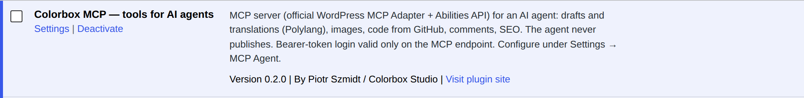
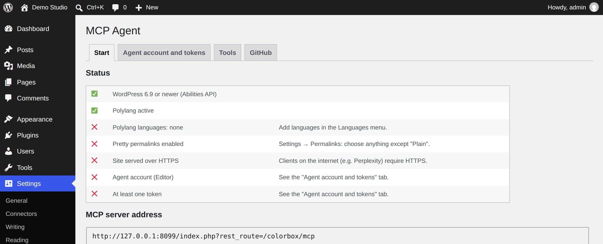

# 1. Installation

*[Polski → ../pl/01-instalacja.md](../pl/01-instalacja.md)*

This chapter takes you from nothing to an installed, active plugin. It takes about 15 minutes if your site already
runs Polylang.

## What you need

| What | Why | How to check |
|---|---|---|
| WordPress **6.9 or newer** | The plugin uses the Abilities API that arrived in WordPress 6.9. | **Dashboard → Updates** shows your version. |
| PHP **8.1 or newer** with the `sodium` extension | `sodium` encrypts the optional GitHub token. It is on by default in PHP 7.2+, but some hosts disable it. | **Tools → Site Health → Info → Server**. |
| [Polylang](https://wordpress.org/plugins/polylang/) with **at least one language** | The language and translation tools rely on it. One language is enough if your site is not multilingual. | **Languages** menu in wp-admin. |
| **Pretty permalinks** (anything except “Plain”) | The MCP address `/wp-json/colorbox/mcp` needs them. | **Settings → Permalinks**. |
| **HTTPS** | Clients that connect from the internet (Perplexity) refuse plain HTTP. A local client (Claude Code on your own network) works without it. | Your site address starts with `https://`. |

You do **not** need Composer, SSH or a terminal: everything the plugin needs is inside the ZIP.

## Step by step

1. **Get the ZIP.** On the repository page open **Releases** and download `colorbox-wp-mcp-<version>.zip`.
   *If there is no release*, use **Code → Download ZIP**. It works the same, but WordPress will name the plugin
   folder `colorbox-mcp-main`. That only matters if you later switch to a release ZIP: delete the old folder first.
2. **Upload it.** In wp-admin go to **Plugins → Add Plugin → Upload Plugin**, choose the ZIP and click
   **Install Now**.
   → You see “Plugin installed successfully”.
3. **Activate it.** Click **Activate Plugin**.
   → The plugin list shows **Colorbox MCP — tools for AI agents** with a **Settings** link.

   

4. **Polylang** (skip if you already have it): **Plugins → Add Plugin**, search “Polylang”, **Install Now**,
   **Activate**. Then **Languages → Languages**: add at least one language (for example English). Polylang offers a
   setup wizard; you can use it or skip it.
5. **Permalinks** (skip if already set): **Settings → Permalinks**, choose for example **Post name**, click
   **Save Changes**.
6. **Check the result.** Go to **Settings → MCP Agent**. The **Start** tab lists every requirement with ✅ or ❌
   and a hint how to fix each ❌.

   

   The last two rows (agent account, token) turn green in the next chapter.

## Language of the plugin

The plugin speaks the language of your WordPress: the admin panel follows your profile language, and the
descriptions the agent reads follow the site language (**Settings → General → Site Language**). English and Polish
are included; any other language falls back to English.

## Updating

There is no automatic update. Download the new ZIP and upload it the same way; WordPress asks
**Replace current with uploaded** — confirm. Tokens, settings and the agent account stay.

## Removing

**Plugins → Deactivate**, then **Delete**. The MCP address stops working immediately, so every token stops working
too. Note: the plugin does not delete its settings from the database (option names start with `colorbox_mcp_`) or
the agent account; delete the account in **Users** if you do not need it.

---

Next: [2. Configuration →](02-configuration.md)
