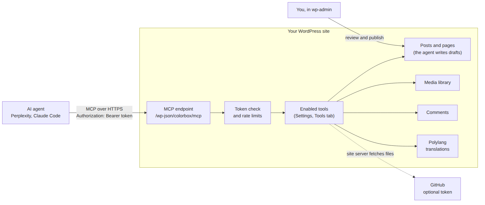

# 7. How it works

*[Polski → ../pl/07-jak-to-dziala.md](../pl/07-jak-to-dziala.md)*

For the curious and for anyone who wants to change the code.



## The path of one request

1. The client sends a JSON-RPC message (MCP) to `/wp-json/colorbox/mcp` with the token in a header.
2. `includes/auth.php` finds the token by its SHA-256 fingerprint and signs the request in as the token's account
   — **only on this address**. Then it applies the rate limits.
3. The official [WordPress MCP Adapter](https://github.com/WordPress/mcp-adapter) (in `vendor/`) handles MCP and
   offers the tools listed by `includes/server.php`, minus the ones disabled in the panel.
4. Each tool is a WordPress **ability** (the Abilities API in WordPress core, `includes/abilities.php`). Before
   running, the ability checks that the account may do it (for example `edit_post` for that post).
5. The work itself happens in ordinary WordPress functions (`wp_insert_post`, `media_handle_sideload`, …), so
   revisions, hooks and other plugins behave as if a person did it.

## Files

| File | What is in it |
|---|---|
| `colorbox-wp-mcp.php` | Plugin header, constants, loading the parts. |
| `includes/server.php` | The MCP server at `/wp-json/colorbox/mcp` with an explicit tool list. The adapter's default server (with a generic “run any ability” tool) is turned off. |
| `includes/auth.php` | Tokens, sign-in only on the MCP address, rate limits, the temporary header log. |
| `includes/abilities.php` | All 29 tools: names, descriptions, input/output schemas, permission checks. |
| `includes/content.php` | Posts, pages, categories, languages and translations (Polylang). |
| `includes/manage.php` | ⚠ tools: published posts, revisions, trash, deleting categories and images. |
| `includes/media.php` | Image import (GitHub, address, base64) and the encrypted GitHub token. |
| `includes/code.php` | Code fragments from GitHub pinned to a commit. |
| `includes/document.php` | Markdown documents from GitHub converted to blocks. |
| `includes/comments.php` | Comment review, flags, the *Agent* column and filter. |
| `includes/review.php` | Dashboard box and admin-bar counter for the review queue. |
| `includes/audit.php` | The content audit report. |
| `includes/seo.php` | Meta description, Open Graph and Twitter tags. |
| `includes/settings.php` | The **Settings → MCP Agent** panel. |
| `includes/i18n.php` | Loads the translation matching the WordPress language. |
| `includes/cli.php` | WP-CLI commands (optional). |
| `languages/` | Polish translation (`.po` source, `.mo` and `.l10n.php` compiled) and the `.pot` template. |
| `vendor/` | MCP Adapter and its autoloader, committed so that no Composer is needed. |
| `tools/` | Demo site, screenshots and diagrams for this documentation — not part of the ZIP. |

## What the plugin stores

| Where | Name | Content |
|---|---|---|
| Option | `colorbox_mcp_tokens` | Token fingerprints, account, name, dates. |
| Option | `colorbox_mcp_disabled_tools` | Tools switched off in the panel. Missing = the defaults. |
| Option | `colorbox_mcp_github_token` | The encrypted GitHub token. |
| Option | `colorbox_mcp_base64_mb` | The base64 image limit in MB. Missing = 4. |
| Options | `colorbox_mcp_c_…` | Rate-limit counters (short-lived). |
| Post meta | `_colorbox_seo_description`, `_colorbox_social_image` | SEO fields. |
| Post meta | `_colorbox_review_note` | The agent's note for review. |
| Post meta | `_colorbox_agent_log` | The last 20 ⚠ actions and date changes (`set-date`, old and new date) on that post: tool, reason, time, account. |
| Comment meta | `_colorbox_flag`, `_colorbox_flag_reason`, … | Agent flags; `_colorbox_prev_content` for undoing an edit. |

## Design decisions

- **Own token instead of WordPress application passwords.** An application password opens the whole REST API with
  all of the account's rights. A token valid only on one address limits a leak to the enabled tools.
- **An explicit list of tools instead of the adapter's generic “execute ability” tool.** The client sees exactly
  what you enabled, with annotations (`readOnlyHint`, `destructiveHint`) that clients like Perplexity use to ask
  for confirmation.
- **No publishing tool at all**, not even an optional one. Publishing is the moment a human takes responsibility.
- **⚠ tools need a `reason` and leave a log** on the post, so you can see later why something changed.
- **The front page and the posts page are protected in every language.** WordPress protects only the
  default-language ones; Polylang translations of them would otherwise be trashable.
- **Polylang required, not optional.** Most of the work on a bilingual site is translation; making languages
  optional would double the code paths. A single-language site just has one language in Polylang.
- **Code highlighting left to the theme.** Bundling a highlighter would load scripts on every page for a feature
  many sites already have.
- **Review queue in wp-admin instead of e-mail.** Many WordPress servers have no working mail.

## Known limitations

- No OAuth, so claude.ai custom connectors cannot use it.
- No automatic updates.
- Deleting the plugin leaves its options and the agent account.
- Tested with WordPress 7.1, PHP 8.3, Polylang 3.9, Perplexity and Claude Code. Other clients and Polylang Pro are
  not tested.

## Development

### Try it locally

`tools/demo/` contains a throwaway WordPress in Docker with invented content:

```bash
cd tools/demo
../../bin/build-zip.sh zip
docker compose up -d
./seed.sh
```

Open `http://127.0.0.1:8099/wp-admin` (login `admin`, password `demo-pass-123`). `docker compose down -v` removes it.

### Tests

`tools/demo/test-date.sh` runs the post date tests (`tools/demo/test-date.php`) on the demo site: it calls the
tools the way the MCP server does, as an Editor account, and checks a backdated draft before and after publishing,
refusal of future dates and bad formats, the log and undo in `update-published-post`. Exit code 0 = all passed.
The site must be set up from a ZIP of the current code (steps above).

### Screenshots for these docs

```bash
pip install playwright && playwright install chromium
python3 tools/screenshots.py en      # English admin
tools/demo/seed.sh lang pl && python3 tools/screenshots.py pl && tools/demo/seed.sh lang en
```

Diagrams: `tools/diagrams/*.mmd`, rendered with
`mmdc -i tools/diagrams/how-it-works-en.mmd -o docs/img/how-it-works-en.png -b white -s 2`.

### Dependencies

`composer install --no-dev`. The MCP Adapter version is pinned in `composer.lock`; `vendor/` is committed.

### Translations

English is the source language. After changing any text in the code, run these in the repository root with WP-CLI
(no WordPress installation needed; without WP-CLI, prefix each line with
`docker run --rm -u $(id -u):$(id -g) -v $PWD:/p -w /p wordpress:cli`):

```bash
wp i18n make-pot . languages/colorbox-wp-mcp.pot --exclude=vendor,tools,dist
wp i18n update-po languages/colorbox-wp-mcp.pot languages/
# translate the new entries in languages/colorbox-wp-mcp-pl_PL.po, then:
wp i18n make-mo languages/ && wp i18n make-php languages/
```

A new language: copy the `.pot` to `languages/colorbox-wp-mcp-<locale>.po`, translate it, then run the last line.

### Adding your own tools

A tool that only makes sense on your site (a camera on your desk, an internal service) does not need a fork.
Put it in a small separate plugin or mu-plugin:

1. Register a WordPress ability on `wp_abilities_api_init`, with category `colorbox` and
   `'meta' => array( 'mcp' => array( 'public' => false ) )`.
2. Add its name to the server with the `colorbox_mcp_tools` filter:
   `add_filter( 'colorbox_mcp_tools', fn( $tools ) => array_merge( $tools, array( 'my/tool' ) ) );`
3. To save an image you fetched yourself, call
   `Colorbox\WpMcp\Media\import_bytes( array( 'bytes' => …, 'name' => 'photo.jpg', 'source' => 'my-source' ), $input )`.
   It checks the type, reuses duplicates, sets `alt`/`caption` and returns the same result as `colorbox-import-image`.

Such tools do not appear in the **Tools** tab; to turn one off, deactivate its plugin.

To tell agents about something your site has (for example blocks of your theme), append to the server instructions —
the text clients show the model before the tools:
`add_filter( 'colorbox_mcp_instructions', fn( $text ) => $text . "\n\nThis site also has …" );`

### Release

Every change that will ship gets an entry in `CHANGELOG.md` and `CHANGELOG.pl.md` right away, under the next
version ("not released yet"). At release time:

1. Bump the version in both the header and `const VERSION` of `colorbox-wp-mcp.php`, and in the “Status”
   paragraph of both READMEs.
2. In both changelogs replace “not released yet” with the release date and point the version link at the bottom
   to `releases/tag/v<version>`.
3. `bin/build-zip.sh` writes `dist/colorbox-wp-mcp-<version>.zip` with only what the site needs (changelog
   included).
4. The GitHub release notes are the `CHANGELOG.md` entry for that version, plus one line on installing the ZIP.

---

Back to [README](../../README.md)
