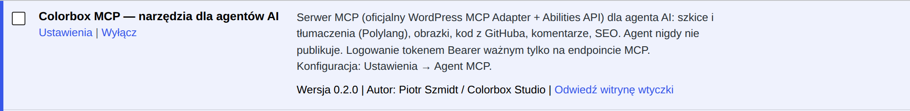
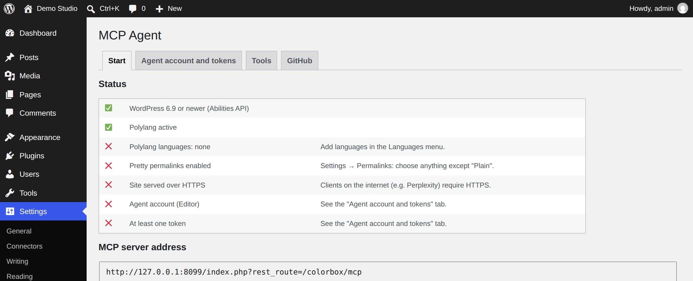

# 1. Instalacja

*[English → ../en/01-installation.md](../en/01-installation.md)*

Ten rozdział prowadzi od zera do zainstalowanej i włączonej wtyczki. Zajmuje około 15 minut, jeśli strona ma już
Polylanga.

## Co jest potrzebne

| Co | Po co | Jak sprawdzić |
|---|---|---|
| WordPress **6.9 lub nowszy** | Wtyczka korzysta z Abilities API, które weszło w WordPressie 6.9. | **Kokpit → Aktualizacje** pokazuje wersję. |
| PHP **8.1 lub nowszy** z rozszerzeniem `sodium` | `sodium` szyfruje opcjonalny token GitHub. Jest domyślnie włączone od PHP 7.2, ale niektóre hostingi je wyłączają. | **Narzędzia → Stan witryny → Informacja → Serwer**. |
| [Polylang](https://pl.wordpress.org/plugins/polylang/) z **co najmniej jednym językiem** | Narzędzia języków i tłumaczeń z niego korzystają. Jeden język wystarczy, jeśli strona nie jest wielojęzyczna. | Menu **Języki** w panelu. |
| **Bezpośrednie odnośniki** inne niż „Prosty” | Adres MCP `/wp-json/colorbox/mcp` ich wymaga. | **Ustawienia → Bezpośrednie odnośniki**. |
| **HTTPS** | Klienci łączący się z internetu (Perplexity) odrzucają zwykłe HTTP. Klient lokalny (Claude Code w Twojej sieci) działa bez tego. | Adres strony zaczyna się od `https://`. |

**Nie** potrzebujesz Composera, SSH ani terminala: wszystko, czego wtyczka potrzebuje, jest w pliku ZIP.

## Krok po kroku

1. **Pobierz ZIP.** Na [stronie repozytorium](https://github.com/szmidtpiotr/colorbox-mcp) otwórz **Releases**
   (prawa kolumna) → najnowsza wersja → **Assets** → `colorbox-wp-mcp-<wersja>.zip`. Nie rozpakowuj go.
   Inne sposoby pobrania wtyczki z GitHuba są niżej, w części *Inne sposoby instalacji z GitHuba*.
2. **Wyślij go.** W panelu: **Wtyczki → Dodaj wtyczkę → Wyślij wtyczkę na serwer**, wskaż ZIP, kliknij
   **Zainstaluj teraz**.
   → Widać „Wtyczka została zainstalowana.”
3. **Włącz ją.** Kliknij **Włącz wtyczkę**.
   → Na liście wtyczek jest **Colorbox MCP — narzędzia dla agentów AI** z odnośnikiem **Ustawienia**.

   

4. **Polylang** (pomiń, jeśli już jest): **Wtyczki → Dodaj wtyczkę**, wyszukaj „Polylang”, **Zainstaluj teraz**,
   **Włącz**. Potem **Języki → Języki**: dodaj co najmniej jeden język (np. polski). Polylang proponuje kreatora
   konfiguracji; można go użyć albo pominąć.
5. **Bezpośrednie odnośniki** (pomiń, jeśli już ustawione): **Ustawienia → Bezpośrednie odnośniki**, wybierz np.
   **Nazwa wpisu**, kliknij **Zapisz zmiany**.
6. **Sprawdź wynik.** Wejdź w **Ustawienia → Agent MCP**. Zakładka **Start** pokazuje każde wymaganie z ✅ albo ❌
   i podpowiedź, jak poprawić każde ❌. Na tym zrzucie panel jest po angielsku, bo tak był ustawiony profil:

   

   Dwa ostatnie wiersze (konto agenta, token) zazielenią się w następnym rozdziale.

## Inne sposoby instalacji z GitHuba

ZIP z wydania (wyżej) to sposób zalecany: zawiera tylko to, czego potrzebuje strona, a nazwa katalogu
(`colorbox-wp-mcp`) jest taka sama w każdej wersji, więc aktualizacja podmienia wtyczkę na miejscu. Dwa sposoby
poniżej też działają.

### Code → Download ZIP (najnowszy kod, bez czekania na wydanie)

1. Na stronie repozytorium kliknij zielony przycisk **Code** → **Download ZIP**.
   → Pobiera się `colorbox-mcp-main.zip`. Nie rozpakowuj go.
2. Wyślij go jak ZIP z wydania: **Wtyczki → Dodaj wtyczkę → Wyślij wtyczkę na serwer → Zainstaluj teraz →
   Włącz wtyczkę**.

Różnice względem ZIP-a z wydania:

- Wtyczka ląduje w katalogu `colorbox-mcp-main` zamiast `colorbox-wp-mcp`. WordPress traktuje je jak dwie różne
  wtyczki. **Jeśli kiedyś przechodzisz z jednego rodzaju ZIP-a na drugi, najpierw wyłącz i usuń starą wtyczkę**
  (tokeny i ustawienia zostają, są w bazie), inaczej będziesz mieć dwie kopie.
- W ZIP-ie są też `docs/` i `tools/` (dokumentacja, strona demo, skrypt zrzutów). Na stronie nic nie robią, zajmują
  tylko kilka MB.
- `main` to kod wydany. Prace w toku są na gałęzi `develop`; tej nie instaluj na działającej stronie.

### git clone (jeśli masz dostęp SSH do serwera)

```bash
cd wp-content/plugins
git clone https://github.com/szmidtpiotr/colorbox-mcp.git colorbox-wp-mcp
```

Potem **Wtyczki → Colorbox MCP → Włącz**. Późniejsza aktualizacja: `git pull` w tym katalogu. Pliki muszą być
czytelne dla użytkownika serwera WWW (często `www-data`). Composer nie jest potrzebny: `vendor/` jest w repozytorium.

## Język wtyczki

Wtyczka mówi językiem Twojego WordPressa: panel jest w języku Twojego profilu, a opisy narzędzi, które czyta agent —
w języku strony (**Ustawienia → Ogólne → Język witryny**). W zestawie są polski i angielski; każdy inny język
dostaje angielski.

## Aktualizacja

Nie ma automatycznych aktualizacji. Pobierz nowy ZIP i wyślij go tak samo; WordPress zapyta, czy zastąpić obecną
wersję wysłaną — potwierdź. Tokeny, ustawienia i konto agenta zostają. Użyj tego samego rodzaju ZIP-a
co za pierwszym razem (patrz *Inne sposoby instalacji z GitHuba*). Przy `git clone` wystarczy `git pull`.

Żeby dostawać powiadomienia o nowych wersjach, kliknij na stronie repozytorium **Watch → Custom → Releases**.

## Usunięcie

**Wtyczki → Wyłącz**, potem **Usuń**. Adres MCP przestaje działać od razu, więc wszystkie tokeny też. Uwaga: wtyczka
nie kasuje swoich ustawień z bazy (nazwy opcji zaczynają się od `colorbox_mcp_`) ani konta agenta; konto usuń
w **Użytkownicy**, jeśli nie jest potrzebne.

---

Dalej: [2. Konfiguracja →](02-konfiguracja.md)
