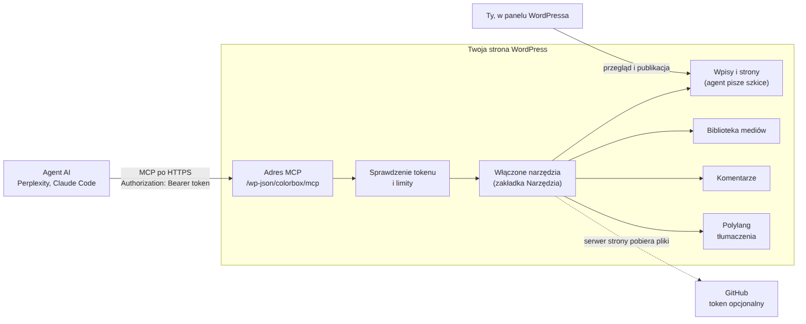

# 7. Jak to działa

*[English → ../en/07-how-it-works.md](../en/07-how-it-works.md)*

Dla ciekawych i dla każdego, kto chce zmieniać kod.



## Droga jednego zapytania

1. Klient wysyła wiadomość JSON-RPC (MCP) na `/wp-json/colorbox/mcp` z tokenem w nagłówku.
2. `includes/auth.php` znajduje token po odcisku SHA-256 i loguje zapytanie jako konto przypisane do tokenu —
   **tylko na tym adresie**. Potem sprawdza limity.
3. Oficjalny [WordPress MCP Adapter](https://github.com/WordPress/mcp-adapter) (w `vendor/`) obsługuje protokół MCP
   i udostępnia narzędzia z listy w `includes/server.php`, bez tych wyłączonych w panelu.
4. Każde narzędzie to **ability** WordPressa (Abilities API z rdzenia, `includes/abilities.php`). Przed
   wykonaniem sprawdza, czy konto może to zrobić (np. `edit_post` dla danego wpisu).
5. Samą pracę wykonują zwykłe funkcje WordPressa (`wp_insert_post`, `media_handle_sideload`, …), więc wersje,
   haki i inne wtyczki działają tak, jakby robił to człowiek.

## Pliki

| Plik | Co zawiera |
|---|---|
| `colorbox-wp-mcp.php` | Nagłówek wtyczki, stałe, ładowanie części. |
| `includes/server.php` | Serwer MCP pod `/wp-json/colorbox/mcp` z jawną listą narzędzi. Domyślny serwer adaptera (z ogólnym narzędziem „uruchom dowolną ability”) jest wyłączony. |
| `includes/auth.php` | Tokeny, logowanie tylko na adresie MCP, limity, tymczasowy zapis nagłówków. |
| `includes/abilities.php` | Wszystkie 28 narzędzi: nazwy, opisy, schematy wejścia i wyjścia, sprawdzanie uprawnień. |
| `includes/content.php` | Wpisy, strony, kategorie, języki i tłumaczenia (Polylang). |
| `includes/manage.php` | Narzędzia ⚠: opublikowane wpisy, wersje, kosz, usuwanie kategorii i obrazków. |
| `includes/media.php` | Import obrazków (GitHub, adres, base64) i zaszyfrowany token GitHub. |
| `includes/code.php` | Fragmenty kodu z GitHuba przypięte do commita. |
| `includes/comments.php` | Przegląd komentarzy, oznaczenia, kolumna i filtr *Agent*. |
| `includes/review.php` | Ramka w kokpicie i licznik na pasku dla kolejki do przeglądu. |
| `includes/audit.php` | Raport braków w treściach. |
| `includes/seo.php` | Opis meta, znaczniki Open Graph i Twitter. |
| `includes/settings.php` | Panel **Ustawienia → Agent MCP**. |
| `includes/i18n.php` | Ładuje tłumaczenie pasujące do języka WordPressa. |
| `includes/cli.php` | Polecenia WP-CLI (opcjonalne). |
| `languages/` | Tłumaczenie polskie (źródło `.po`, skompilowane `.mo` i `.l10n.php`) i szablon `.pot`. |
| `vendor/` | MCP Adapter z autoloaderem, w repozytorium, żeby nie był potrzebny Composer. |
| `tools/` | Strona demo, zrzuty i schematy do tej dokumentacji — nie trafia do ZIP-a. |

## Co wtyczka zapisuje

| Gdzie | Nazwa | Zawartość |
|---|---|---|
| Opcja | `colorbox_mcp_tokens` | Odciski tokenów, konto, nazwa, daty. |
| Opcja | `colorbox_mcp_disabled_tools` | Narzędzia wyłączone w panelu. Brak opcji = ustawienia domyślne. |
| Opcja | `colorbox_mcp_github_token` | Zaszyfrowany token GitHub. |
| Opcja | `colorbox_mcp_base64_mb` | Limit obrazków base64 w MB. Brak opcji = 4. |
| Opcje | `colorbox_mcp_c_…` | Liczniki limitów (krótkotrwałe). |
| Meta wpisu | `_colorbox_seo_description`, `_colorbox_social_image` | Pola SEO. |
| Meta wpisu | `_colorbox_review_note` | Notatka agenta do przeglądu. |
| Meta wpisu | `_colorbox_agent_log` | 20 ostatnich akcji ⚠ na tym wpisie: narzędzie, powód, czas, konto. |
| Meta komentarza | `_colorbox_flag`, `_colorbox_flag_reason`, … | Oznaczenia agenta; `_colorbox_prev_content` do cofnięcia poprawki. |

## Decyzje projektowe

- **Własny token zamiast haseł aplikacji WordPressa.** Hasło aplikacji otwiera całe REST API ze wszystkimi
  uprawnieniami konta. Token ważny tylko na jednym adresie ogranicza skutki wycieku do włączonych narzędzi.
- **Jawna lista narzędzi zamiast ogólnego narzędzia adaptera „wykonaj ability”.** Klient widzi dokładnie to, co
  włączyłeś, z adnotacjami (`readOnlyHint`, `destructiveHint`), których klienci tacy jak Perplexity używają, żeby
  prosić o potwierdzenie.
- **Żadnego narzędzia do publikowania**, nawet opcjonalnego. Publikacja to moment, w którym odpowiedzialność bierze
  człowiek.
- **Narzędzia ⚠ wymagają powodu i zostawiają ślad** przy wpisie, więc później widać, dlaczego coś się zmieniło.
- **Strona główna i strona wpisów są chronione w każdym języku.** WordPress chroni tylko te w języku domyślnym;
  ich tłumaczenia z Polylanga dałoby się inaczej wyrzucić do kosza.
- **Polylang wymagany, nie opcjonalny.** Większość pracy na stronie dwujęzycznej to tłumaczenia; opcjonalne języki
  podwoiłyby ścieżki w kodzie. Strona jednojęzyczna ma po prostu jeden język w Polylangu.
- **Kolorowanie kodu zostawione motywowi.** Dołączony skrypt ładowałby się na każdej stronie, a wiele stron już go
  ma.
- **Kolejka do przeglądu w panelu zamiast e-maila.** Wiele serwerów WordPressa nie ma działającej poczty.

## Znane ograniczenia

- Brak OAuth, więc własne łączniki claude.ai nie zadziałają.
- Brak automatycznych aktualizacji.
- Usunięcie wtyczki zostawia jej opcje i konto agenta.
- Przetestowane z WordPressem 7.1, PHP 8.3, Polylangiem 3.9, Perplexity i Claude Code. Inni klienci i Polylang Pro
  nie były testowane.

## Rozwój

### Wypróbowanie lokalnie

`tools/demo/` zawiera jednorazowego WordPressa w Dockerze z wymyślonymi treściami:

```bash
cd tools/demo
../../bin/build-zip.sh zip
docker compose up -d
./seed.sh
```

Otwórz `http://127.0.0.1:8099/wp-admin` (login `admin`, hasło `demo-pass-123`). `docker compose down -v` usuwa
wszystko.

### Zrzuty do dokumentacji

```bash
pip install playwright && playwright install chromium
python3 tools/screenshots.py en      # panel po angielsku
tools/demo/seed.sh lang pl && python3 tools/screenshots.py pl && tools/demo/seed.sh lang en
```

Schematy: `tools/diagrams/*.mmd`, renderowane poleceniem
`mmdc -i tools/diagrams/how-it-works-pl.mmd -o docs/img/how-it-works-pl.png -b white -s 2`.

### Zależności

`composer install --no-dev`. Wersja MCP Adapter jest przypięta w `composer.lock`; `vendor/` jest w repozytorium.

### Tłumaczenia

Językiem źródłowym jest angielski. Po zmianie tekstów w kodzie uruchom w katalogu repozytorium (z WP-CLI; instalacja
WordPressa nie jest potrzebna; bez WP-CLI poprzedź każdą linię
`docker run --rm -u $(id -u):$(id -g) -v $PWD:/p -w /p wordpress:cli`):

```bash
wp i18n make-pot . languages/colorbox-wp-mcp.pot --exclude=vendor,tools,dist
wp i18n update-po languages/colorbox-wp-mcp.pot languages/
# przetłumacz nowe pozycje w languages/colorbox-wp-mcp-pl_PL.po, potem:
wp i18n make-mo languages/ && wp i18n make-php languages/
```

Nowy język: skopiuj `.pot` do `languages/colorbox-wp-mcp-<locale>.po`, przetłumacz i uruchom ostatnią linię.

### ZIP do wydania

`bin/build-zip.sh` zapisuje `dist/colorbox-wp-mcp-<wersja>.zip` tylko z tym, czego potrzebuje strona. Podnieś
wersję w nagłówku i w `const VERSION` w `colorbox-wp-mcp.php`.

---

Powrót do [README](../../README.pl.md)
